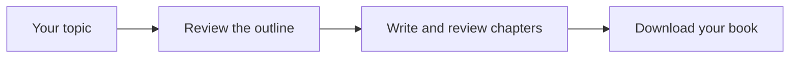
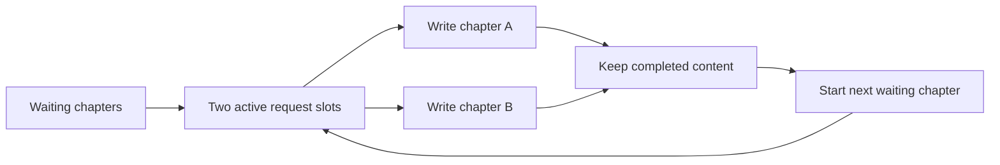
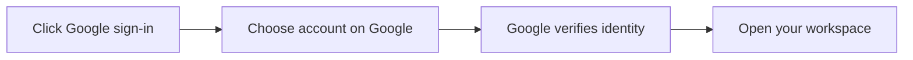
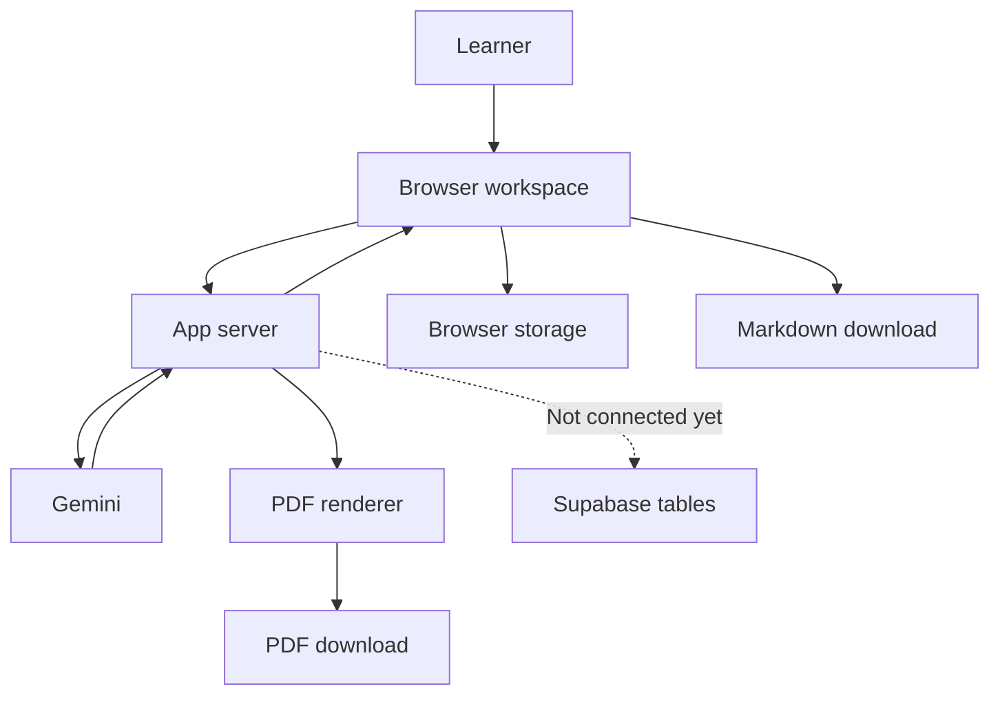
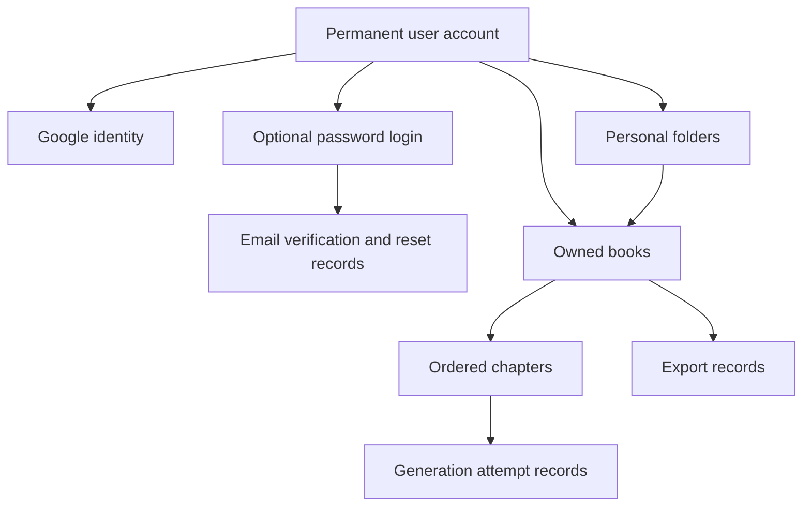

# Learning Space Application Guide

**What it does, how to use it, and how its parts work together**

Reviewed: 20 November 2026

**Development update:** This guide's workflows describe the deployed application. The current development branch additionally implements permanent account profiles, email/password signup, verification, recovery, and session revocation. Those changes are tested locally against Supabase but are not deployed. Resend now delivers test verification/recovery emails to the owner; public sending needs an owned, verified domain. See [AUTH_SETUP.md](AUTH_SETUP.md). Cloud book saving remains pending.

Learning Space turns a learning topic into a structured book. You create the outline first, generate chapters, then download the assembled book as Markdown or PDF. It supports Myanmar text, formatted tables, code examples, and diagrams.

Open the app: https://learning-space-delta.vercel.app/

**Current position:** Book generation, downloads, and Google sign-in work. Google sign-in is configured in Testing mode with the owner registered as a test user. The Supabase database tables are installed, but the application is not connected to them yet. Books currently stay in the browser where they were created.

## 1. Create a book

Start with a specific learning goal. For example: “Teach MCP in Burmese, from basic concepts to building a small working server.” Mention the language, your experience, and the practical result you want.

1. **Enter your topic.** Use the main topic field. The app accepts up to 10,000 characters.
2. **Generate an outline.** The app asks Gemini for a book title, chapter list, learning goals, prerequisites, and estimated page counts. An outline is the plan; it is not the finished book.
3. **Review the plan.** Check the chapter order and whether the planned topics match your goal. Direct outline editing is not implemented yet. Create a new outline if the plan is unsuitable; download existing work before replacing it.
4. **Write a chapter or write all chapters.** An individual chapter can be generated on its own. “Write all chapters” processes the outline with at most two chapter requests active at once.
5. **Review the content.** Check explanations and try the practical examples. The app checks structure and minimum content length, but those checks do not prove that every explanation or code sample is correct.
6. **Retry or regenerate when needed.** A failed chapter can be retried. Regenerating a chapter replaces its content after a successful response; it does not create a version history.
7. **Download the book.** Choose Markdown for an editable text manuscript or PDF for reading and sharing. Download again to include later chapter changes.

**Example:** A book has chapters 1, 2, 3, and 4. Chapter 2 may finish before chapter 1, but the assembled manuscript still puts chapter 1 first. Estimated pages guide generation; they are not a guaranteed PDF page count.

## 2. Understand simultaneous chapter writing

The app uses a queue: it starts two chapters, then starts another whenever a slot becomes free. This makes the work concurrent without starting every chapter at once.

If a chapter fails, the app stops starting new waiting chapters. Requests already running can finish, and their successful results are kept. Retry the failed chapter or use “Write all chapters” to fill the missing chapters. When every chapter is already written, the batch action becomes “Regenerate all chapters.”

This two-request limit applies to the current browser batch. Server-wide quotas, cancellation, and durable background generation are still planned.

Each chapter receives outline information, goals, prerequisites, and the next chapter title. It does not receive the full text of every preceding chapter. The prompts encourage continuity, but reviewing the assembled book is still necessary to catch repeated explanations.

## 3. Understand Google sign-in

Choose “Continue with Google,” select your Google account, and complete Google's consent screen if shown. Google returns a verified identity to Learning Space, which creates an encrypted login session. The account page displays your name and email.

Your Google password stays with Google. Learning Space requests basic identity information: name, email, and profile. It does not request Gmail or Google Drive access.

Sign-in currently separates the guest workspace from the signed-in workspace on that browser. Signing out returns to the guest workspace. Signing in does not yet create a durable account record in PostgreSQL or upload your books.

**Testing access:** The owner's Google account has completed real login, reload, and sign-out checks both locally and on the deployed site. Other accounts and Google's public publishing requirements need separate verification before a public launch.

**Important distinction:** A login session answers “Who is using the app?” Cloud storage answers “Where is this person's work saved?” Login is working; cloud saving is the next integration stage.

## 4. See where your content goes today

Solid arrows show active data flow. The dotted arrow marks the pending database integration. The browser displays the workspace and stores its recoverable outline and chapters. The server sends generation requests to Gemini, renders PDFs, and returns downloads to your device.

Browser storage belongs to the current browser profile and website address. The same Google login on a phone and laptop does not yet bring the same books to both devices. Localhost and the deployed website also have separate browser storage.

Clearing browser/site data can remove saved work. A Markdown or PDF download provides a separate copy, but the app does not yet have an upload-and-restore feature for those files. Existing guest content is not silently imported into an account.

## 5. Understand the database organization

The database is the foundation for future account records and book history. The tables exist in the owner's Supabase project, and both restricted application/authentication connections have passed hosted checks. The sign-in integration and server save/load functions still need to be completed before they store application content.

The account design uses a permanent UUID: an internal account number independent of a Google email address. Google identities and optional password credentials refer to that account. A matching email address alone must not automatically merge two accounts.

The nine tables have these roles:

- **Users:** Permanent account ID, profile, and account status.
- **Identities:** Links a verified Google identity to an account.
- **Password credentials:** Optional registration foundation; stores a password hash rather than a readable password. Password registration is not implemented yet.
- **Email challenges:** Verification and recovery token digests, expiry, and consumption state. Sending verification/reset emails is not implemented yet.
- **Folders:** Personal organization for books; the folder UI is still planned.
- **Books:** Topic, title, language, page estimate, folder, and owner.
- **Chapters:** Outline order, learning goals, sections, and accepted Markdown.
- **Generation attempts:** Which chapter request ran and whether it succeeded or failed. These records do not themselves run background jobs.
- **Exports:** Metadata for future saved PDFs and Markdown files. The actual files belong in private file storage rather than text fields in the database.

Ownership policies protect the content tables. The authentication tables use a separate private schema. Hosted checks confirmed that Supabase's anonymous and standard authenticated API roles cannot access either application schema. Full two-user save/read/download testing belongs to the next application integration stage.

The intended result is simple: you sign in, open your own book history, resume a book on another device, and download only your own files.

## 6. Understand Markdown and PDF exports

**Markdown** is the source text, including headings, tables, code, and diagram instructions. It is useful for editing or keeping an independent copy. Some Markdown viewers display diagram instructions as text unless they support Mermaid.

**PDF** is the reading copy. The server converts Markdown into a printable layout, embeds Myanmar and monospace fonts, and renders supported Mermaid diagrams as graphics. Standard Markdown tables become formatted rows and columns, with repeated headers when they continue to another page.

Existing ASCII diagrams are preserved with monospace alignment. Invalid Mermaid diagrams receive a labeled source fallback. Very large diagrams may shrink to fit the page and should be reviewed for readability.

PDFs already downloaded do not change when the website is updated. Download again to get changes to chapter content or the PDF renderer. There is no saved cloud PDF library yet.

## 7. Follow the remaining implementation steps

The work should proceed in this order:

1. **Account schema - completed.** Permanent account IDs and private login-method records are designed and tested.
2. **Hosted database - setup completed.** All nine tables and restricted roles are installed in Supabase. Both role connections passed TLS, privilege, and ownership-policy checks. The live app is not yet using these connections.
3. **Persistent account profiles - pending.** Resolve verified Google identities to database account IDs, then create/find a durable profile on sign-in.
4. **Cloud books - pending.** Add ownership-checked save/load functions, book history, folders, and cross-device access.
5. **Browser-book import - pending.** Ask before importing local books, prevent duplicate imports, and retain local content until cloud saving succeeds.
6. **Private exports - pending.** Save PDF/Markdown files in private storage and check ownership before every download.
7. **Release checks - pending.** Test two accounts, guest recovery, failed requests, storage cleanup, and database recovery before claiming the cloud features are ready.

Self-service registration needs its chosen method, verification/recovery flow, and mail delivery. Google public publishing, server-side usage limits, and dependency/security work also remain on the project checklist.

## 8. Common situations

**I signed in on my phone but cannot see my laptop book.** Cloud saving is not connected yet. Keep using the browser that holds the book and download a separate copy.

**Only one chapter is still writing.** This can be normal: one request finished while another is still running, or only one chapter remains. Look at the chapter's own status.

**Chapter generation failed.** Retry that chapter. A failure may involve provider configuration, quota, network conditions, or rejected content. The app's current generic error message does not identify every cause precisely.

**My PDF still shows an old diagram.** Existing chapter content and existing downloads do not change automatically. Download again for renderer changes, or regenerate the chapter when newer diagram instructions are needed.

**Can I edit inside the app?** A rendered Markdown editor and chapter-editing interface are planned. For now, download Markdown to edit it outside the app.

**Does signing in save my book online?** Not yet. The login feature is deployed; the database save/load integration is still pending.

## 9. Maintainer reference

The interface uses Next.js and React. Vercel hosts the application server. Gemini generates outlines and chapters. NextAuth handles the Google login session. PostgreSQL on Supabase is the prepared persistence layer. Marked, Mermaid, and Puppeteer/Chromium produce formatted PDF output.

For setup, read `README.md` and `AUTH_SETUP.md`. For the schema and connection, read `db/README.md`. Remaining tasks are in `TODO.md`; PDF history is in `PDF_EXPORT_CHANGES.md`.

Update this guide after database connection, cloud saving, registration, or public Google sign-in changes. Keep “installed,” “connected,” and “available in the interface” separate: they are different milestones.
