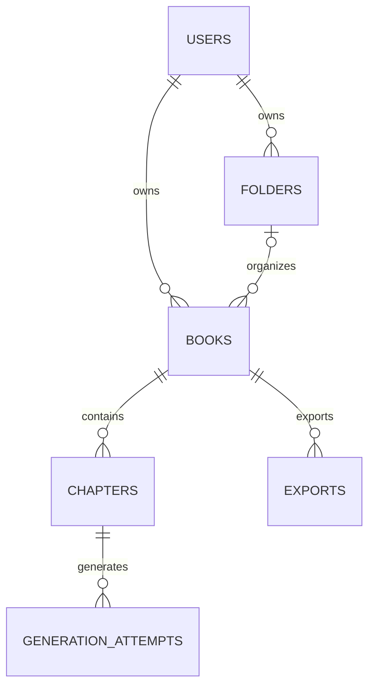

# Database design: Learning Space

Status: proposed PostgreSQL 16+ schema, not a provisioned database and not wired to the app. Existing books remain in browser localStorage. No migration runs automatically during build/deploy. Google login can be tested before connecting a database.

## Entities and ownership



- `users`: name/email plus the current verified `google:<sub>` session ID. Email is mutable and deliberately not a unique identity. No password or Google access/refresh/ID tokens are stored. This supports the current Google-only app; introducing another identity provider later requires a dedicated identities table and an explicit linking flow.
- `folders`: optional, flat personal organization; nested/shared folders are outside this first design.
- `books`: topic, title/subtitle, language (Burmese default), page estimate, optional folder, archive timestamp, optimistic revision and optional guest-import key. Multiple books per user provide book history.
- `chapters`: outline metadata plus accepted Markdown. The `(book_id, chapter_number)` constraint preserves unique outline order. JSON arrays map to `sections` and `prerequisiteConceptsCovered`; application Zod validation must also check string elements. No rendered HTML is stored.
- `generation_attempts`: queued/running/completed/error states for chapter generation, request idempotency, model/prompt version, lease expiry and expected content revision. There can be one active attempt per chapter; different chapters may run concurrently. This records work; it does not create a durable background worker or enforce user-wide quotas.
- `exports`: metadata for future private Markdown/PDF objects, including source book revision, hash and size. Store actual files in private object storage, not database rows or public URLs. Existing on-demand downloads need no export record.

## Current data mapping

`BookOutline.bookTitle/subtitle/estimatedTotalPages` become book columns. Each `tableOfContents` item becomes a chapter row, mapping `chapterTitle` to `title`, `coreGoal` to `core_goal`, and `prerequisiteConceptsCovered` to `prerequisite_concepts`. A `GeneratedChapter.markdown` updates its matching chapter; never identify chapters by title alone. The topic must come from the input form (the legacy saved object does not include it, so import should ask the user). Compile Markdown/PDF from chapters ordered by `chapter_number`. Derive completion counts from accepted Markdown; failed regeneration does not erase previous content.

## Isolation and server contract

All content tables have `owner_id`. Composite foreign keys prevent attaching a user's book to another user's folder or a chapter/attempt/export to another user's book. Row-level security (RLS) applies to reads and writes, including profiles. Use a dedicated runtime role that is neither table owner, superuser nor `BYPASSRLS`; do not use a provider's privileged service role for ordinary requests. No public browser database access is planned.

In each server-side database transaction:

1. Validate the encrypted session with `getAppSession()`; reject anonymous cloud access.
2. Bind the verified `session.user.id` with parameterized SQL: `SELECT set_config('app.user_id', $1, true)`. Never accept owner IDs from the request body or set connection-wide session state. The `true` setting is transaction-local and works with pooled connections when all queries use that same transaction connection.
3. Scope application queries to that owner as well. RLS is a second check; it does not authenticate a request or protect against a compromised server that can impersonate another owner.
4. Commit/rollback before returning the connection. Without context, RLS returns no user rows and rejects inserts. Never expose the database URL to client code.

Provisioning example, run by the administrator after creating the runtime role (credentials managed privately):

```sql
GRANT USAGE ON SCHEMA learning_space TO learning_space_app;
GRANT SELECT, INSERT, UPDATE, DELETE ON ALL TABLES IN SCHEMA learning_space TO learning_space_app;
```

Do not grant DDL, role membership in the migration owner, TRUNCATE, or RLS bypass. Table creation and role grants are separate from the application deployment.

## Writes, imports and cleanup

- On verified login, a future server integration upserts the user's own profile before creating books. Keep the current JWT sessions; this schema is not a drop-in NextAuth adapter. No database session/token tables are required with this design.
- Save outline plus all chapter metadata in one transaction. Outline replacement should create a new book, preserving history and avoiding running jobs writing into a new outline.
- Chapter success uses a conditional update on `content_revision = expected_content_revision`, increments that revision, increments the parent book revision, and marks the attempt succeeded in one transaction. Take a parent book lock first in all book mutation paths to serialize book revisions. Outdated results must not overwrite newer content.
- Retries use new request keys after a terminal failure; HTTP retries of the same request reuse the same key. A future worker must claim jobs atomically, renew leases and expire/recover abandoned attempts. Do not hold database transactions open while calling Gemini or rendering PDFs.
- Folder removal first unlinks its books, then deletes the folder in one transaction. The deferred composite FK avoids accidentally deleting books; deleting a user still cascades through their records.
- Guest import requires explicit confirmation. Validate the legacy outline/chapters, assign a stable import UUID and save transactionally. Preserve local content until cloud success is confirmed. `(owner_id, import_key)` prevents duplicate import on retry.
- Archive preserves content. Permanent deletion cascades through database children. Before deleting books/users, enqueue their private object keys in a durable cleanup mechanism; database cascades do not delete storage objects. A periodic orphan sweep is also needed before enabling permanent deletion in production.
- For export consistency, capture a book revision and its chapter snapshot in one short transaction, render outside it, and retain that captured revision on the export. Download endpoints recheck session ownership and issue short-lived signed URLs or stream bytes from private storage.

## Apply and validate

Use a fresh development PostgreSQL database first, not production. Apply once with `psql "$env:DATABASE_URL" -v ON_ERROR_STOP=1 -f db/migrations/001_initial.sql` in PowerShell, using a privately configured migration connection. `DATABASE_URL` is a future server-only configuration; adding it alone does not connect this app. Use distinct migration/runtime credentials, a provider-supported pool for serverless requests, and backups before storing real books.

After `npm ci`, exercise the schema without an external database using `npm run test:db`. The checker uses the development-only PGlite dependency with an isolated in-memory PostgreSQL database and a nonprivileged runtime role; it never reads credentials. It verifies DDL, ownership, cross-owner constraints, outline order, attempt exclusivity and rollback behavior. It does not establish a hosted connection, durable storage, production grants, parallel-worker behavior, or Google login.

Before integration is complete, test two real accounts against the hosted runtime role: cross-owner list/read/update/delete/import/export denial, pooled connection isolation, concurrent chapter updates and stale results, failed object cleanup, backup recovery and explicit guest import. Add API integration tests when those endpoints exist.

## Implementation sequence

1. Provision development PostgreSQL and validate the migration with separate owner/runtime roles.
2. Connect server-only transactions; upsert verified profiles and add ownership-checked book/chapter APIs.
3. Connect Book Studio/history/folders and explicit guest import, with conflict handling across devices.
4. Add durable generation execution, recovery and quotas; the current two-request client queue remains a UI convenience.
5. Provision private object storage if saved exports are wanted; implement ownership-checked downloads and cleanup.
6. Verify isolation/recovery on staging before production migration and activation.

References: [PostgreSQL RLS](https://www.postgresql.org/docs/current/ddl-rowsecurity.html), [Google OIDC identity](https://developers.google.com/identity/openid-connect/openid-connect).
