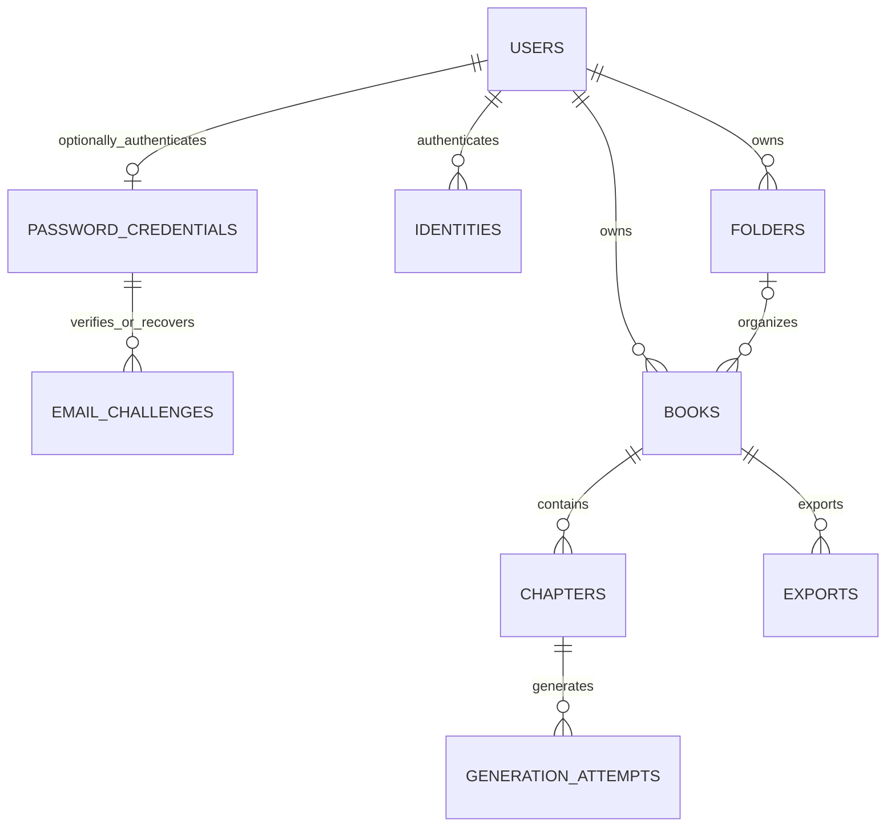

# Database design: Learning Space

Status: schemas and restricted roles installed in the existing Supabase Free **Learning space** project (`wgzfhrtibckrikcppmlq`, Sydney) on 2026-11-20. Both migrations ran in one transaction through the SQL Editor after preflight confirmed zero application tables. PostgreSQL reports nine application/authentication tables. Both restricted role connections pass hosted TLS/privilege/RLS checks. The application's sign-in and book APIs are not wired to the database yet; existing books remain in browser localStorage. No migration runs automatically during build/deploy.

Account schema updated on 2026-11-20: new databases apply `001_initial.sql` then `002_account_identities.sql`. Both are already applied to the named Supabase project; do not rerun them there. The second migration replaces Google-only primary keys with permanent UUID account IDs and adds private authentication tables. The live app still uses its existing Google subject sessions until a later server integration is implemented.

Hosted read-only verification confirmed forced RLS on all six content tables, and no schema USAGE for either `anon` or `authenticated` on either application schema. The three authentication tables intentionally use private schema/table grants rather than content-owner RLS. This verifies metadata/grants, not two-account application behavior or a connection from the deployed app.

## Supabase connection setup and verification

Completed for this project: role provisioning and both `db:check` connections passed on 2026-11-20. Do not rerun provisioning or change existing role passwords. The steps below describe setup for reference; use `npm run db:check` to repeat the read-only connection checks.

1. Add the existing database password privately to the ignored `.env.local`: `SUPABASE_DB_PASSWORD="your-existing-password"`. This is the database password from project creation, not a Supabase API key or Google password. Do not paste it in chat or reset it merely to configure this app.
2. Run `npm run db:provision`. It connects only to this project's session pooler with certificate verification, checks that the UUID schema exists, and creates restricted `learning_space_app` and `learning_space_authenticator` login roles. Existing roles are never silently rotated. This does not change Google sign-in or enable cloud saving.
3. The script writes generated role URLs to ignored `.env.local` as `DATABASE_URL` and `DATABASE_AUTH_URL`. A private `.env.database.pending.local` recovery copy is written before remote role creation. Keep that copy private, especially if provisioning fails; its existence prevents blindly overwriting recovery credentials.
4. Run `npm run db:check` to test both role connections, role flags, forced content RLS, missing-context denial and separation of authentication/content access. It reads no user records or password hashes. Connection errors report safe codes rather than passwords/URLs.
5. Once checks pass, integrate the server authentication/profile and book APIs in the next stage, then save only restricted role URLs to Vercel. Never deploy the administrator password. No database credentials are currently configured in Vercel by these scripts.

The content role can read its own profile through RLS and manage owned books/chapters/folders/attempts/exports. It cannot read authentication tables or create profiles. The authentication role can manage identity/credential/challenge records and create/update profiles with trusted transaction context; it cannot read books. Neither role owns tables or has superuser, create-database, create-role, or RLS-bypass privileges. The privileged administrator connection is used only by the manual provisioning script.

The pooler hostname and project reference were read from this project's Connect dialog and are pinned in `supabase-config.mjs`. Password symbols are URL-encoded and TLS certificate validation cannot be disabled by URL parameters. The official dashboard CA certificate is bundled in `db/certificates/supabase-root-2021.crt`; it resolved `SELF_SIGNED_CERT_IN_CHAIN` without disabling certificate/hostname verification. Its source and fingerprint are documented in `db/certificates/README.md`. [Supabase connection guidance](https://supabase.com/docs/guides/database/connecting-to-postgres), [node-postgres TLS configuration](https://node-postgres.com/features/ssl).

## Entities and ownership



- `users`: permanent UUID, profile name/email, verification timestamp, session version and optional disabled timestamp. Profile email can change and is deliberately not a unique identity. A Google account or a locally registered account owns the same kinds of books through this UUID.
- `learning_space_auth.identities`: verified provider plus subject mapped to a user UUID. `(provider, provider_subject)` is unique. The initial provider is Google; no Google access/refresh/ID tokens are stored. One account can have explicitly linked login methods; matching email addresses must never silently link or merge accounts.
- `learning_space_auth.password_credentials`: optional one-per-user email/password login, with a unique lowercase/trimmed login email, encoded Argon2id hash, verification timestamp and credential revision. Google-only users have no password row. This reserves email/password support without activating registration; the registration method and mail delivery still need implementation decisions. The hash prefix/length constraint rejects ordinary plaintext but cannot prove that a string is a securely generated hash; the future server must generate and validate hashes through a maintained library.
- `learning_space_auth.email_challenges`: optional verification/reset records holding only SHA-256 digests of cryptographically random tokens, purpose, target email, credential revision, expiry and consumption time. This schema limits lifetime to at most 24 hours; choose a shorter reset lifetime in the application. Raw tokens are sent to the recipient through the mail service, never stored in this database.
- `folders`: optional, flat personal organization; nested/shared folders are outside this first design.
- `books`: topic, title/subtitle, language (Burmese default), page estimate, optional folder, archive timestamp, optimistic revision and optional guest-import key. Multiple books per user provide book history.
- `chapters`: outline metadata plus accepted Markdown. The `(book_id, chapter_number)` constraint preserves unique outline order. JSON arrays map to `sections` and `prerequisiteConceptsCovered`; application Zod validation must also check string elements. No rendered HTML is stored.
- `generation_attempts`: queued/running/completed/error states for chapter generation, request idempotency, model/prompt version, lease expiry and expected content revision. There can be one active attempt per chapter; different chapters may run concurrently. This records work; it does not create a durable background worker or enforce user-wide quotas.
- `exports`: metadata for future private Markdown/PDF objects, including source book revision, hash and size. Store actual files in private object storage, not database rows or public URLs. Existing on-demand downloads need no export record.

## Current data mapping

`BookOutline.bookTitle/subtitle/estimatedTotalPages` become book columns. Each `tableOfContents` item becomes a chapter row, mapping `chapterTitle` to `title`, `coreGoal` to `core_goal`, and `prerequisiteConceptsCovered` to `prerequisite_concepts`. A `GeneratedChapter.markdown` updates its matching chapter; never identify chapters by title alone. The topic must come from the input form (the legacy saved object does not include it, so import should ask the user). Compile Markdown/PDF from chapters ordered by `chapter_number`. Derive completion counts from accepted Markdown; failed regeneration does not erase previous content.

## Isolation and server contract

All content tables have `owner_id`. Composite foreign keys prevent attaching a user's book to another user's folder or a chapter/attempt/export to another user's book. Row-level security (RLS) applies to reads and writes, including profiles. Use a dedicated runtime role that is neither table owner, superuser nor `BYPASSRLS`; do not use a provider's privileged service role for ordinary requests. No public browser database access is planned.

In each server-side database transaction:

1. Validate the encrypted session with `getAppSession()`; reject anonymous cloud access.
2. After the future authentication integration maps the verified identity to its database UUID, bind that trusted account UUID with parameterized SQL: `SELECT set_config('app.user_id', $1, true)`. The current `google:<sub>` session subject is not this UUID and must not be used directly. Never accept owner IDs from the request body or set connection-wide session state. The `true` setting is transaction-local and works with pooled connections when all queries use that same transaction connection.
3. Scope application queries to that owner as well. RLS is a second check; it does not authenticate a request or protect against a compromised server that can impersonate another owner.
4. Commit/rollback before returning the connection. Without context, RLS returns no user rows and rejects inserts. Never expose the database URL to client code.

Provisioning example, run by the administrator after creating the runtime role (credentials managed privately):

```sql
GRANT USAGE ON SCHEMA learning_space TO learning_space_app;
GRANT SELECT, INSERT, UPDATE, DELETE ON ALL TABLES IN SCHEMA learning_space TO learning_space_app;
```

Do not grant DDL, role membership in the migration owner, TRUNCATE, or RLS bypass. Table creation and role grants are separate from the application deployment.

The `learning_space_auth` schema is separate and grants nothing to PUBLIC or `learning_space_app`. Its tables are accessed only by a future, separately credentialed server authentication service, never ordinary book APIs or the browser. Do not extend the content-role grants above to authentication tables. Authentication tables use schema/table privilege isolation rather than per-book RLS because verified login requires identity lookup before a user session exists. Integration must provision and test the narrow authentication role separately; do not give it migration-owner privileges. The migration owner is trusted administrative access and can read these records.

Before issuing a future database-backed session, the authentication service must verify Google claims or the password and email verification status, resolve/create the UUID, reject disabled users, and record the UUID/session version. Password resets and account disable operations must revoke sessions by incrementing `users.session_version`; protected requests must compare it. The present JWT implementation does not yet perform these database checks.

## Writes, imports and cleanup

- On verified Google login, look up the provider/subject first. For a new identity, allocate a UUID, set trusted transaction context and create the profile plus identity atomically; handle unique-identity races by returning the already-created account. A matching profile email alone is not permission to link an identity. Linking a second method requires proof of both identities and fresh authentication. This schema is not a drop-in NextAuth adapter; the future JWT subject is the UUID, not the Google subject.
- For future password registration, normalize/validate the email in the server, hash the password with a maintained Argon2id library, and create user/credentials atomically. Never log passwords or hashes or put them in a session/API profile. Require email verification before issuing an active password session. Password storage guidance: [OWASP](https://cheatsheetseries.owasp.org/cheatsheets/Password_Storage_Cheat_Sheet.html).
- Verification/reset endpoints must use generic responses, rate limits and random single-use tokens. Consume a challenge atomically only when its digest, expected purpose, unconsumed status, future expiry, target email and current credential revision match; make the password/verification change in the same transaction. Credential changes increment the revision and invalidate outstanding challenges; password reset also increments the session version. Schema checks do not implement these endpoint rules. See [OWASP recovery guidance](https://cheatsheetseries.owasp.org/cheatsheets/Forgot_Password_Cheat_Sheet.html).
- Save outline plus all chapter metadata in one transaction. Outline replacement should create a new book, preserving history and avoiding running jobs writing into a new outline.
- Chapter success uses a conditional update on `content_revision = expected_content_revision`, increments that revision, increments the parent book revision, and marks the attempt succeeded in one transaction. Take a parent book lock first in all book mutation paths to serialize book revisions. Outdated results must not overwrite newer content.
- Retries use new request keys after a terminal failure; HTTP retries of the same request reuse the same key. A future worker must claim jobs atomically, renew leases and expire/recover abandoned attempts. Do not hold database transactions open while calling Gemini or rendering PDFs.
- Folder removal first unlinks its books, then deletes the folder in one transaction. The deferred composite FK avoids accidentally deleting books; deleting a user still cascades through their records.
- Guest import requires explicit confirmation. Validate the legacy outline/chapters, assign a stable import UUID and save transactionally. Preserve local content until cloud success is confirmed. `(owner_id, import_key)` prevents duplicate import on retry.
- Archive preserves content. Permanent deletion cascades through database children. Before deleting books/users, enqueue their private object keys in a durable cleanup mechanism; database cascades do not delete storage objects. A periodic orphan sweep is also needed before enabling permanent deletion in production.
- For export consistency, capture a book revision and its chapter snapshot in one short transaction, render outside it, and retain that captured revision on the export. Download endpoints recheck session ownership and issue short-lived signed URLs or stream bytes from private storage.

## Apply and validate

Use a fresh development PostgreSQL database first, not production. Run both commands once, in order, in PowerShell using a privately configured migration connection:

```powershell
psql "$env:DATABASE_URL" -v ON_ERROR_STOP=1 -f db/migrations/001_initial.sql
psql "$env:DATABASE_URL" -v ON_ERROR_STOP=1 -f db/migrations/002_account_identities.sql
```

If `001` is already applied, apply only `002`. Never rerun either migration blindly. `002` takes exclusive locks and converts all existing owner keys in one transaction, while preserving Google subjects in `identities`; test downtime and backup/restore before running on a populated hosted database. It does not infer historical email verification. RLS is temporarily disabled only inside the locked migration transaction and restored with UUID ownership policies before commit. Migrations must run with the schema owner, not the runtime role.

`DATABASE_URL` is a future server-only configuration; adding it alone does not connect this app. Use distinct migration/runtime/authentication credentials, a provider-supported pool for serverless requests, and backups before storing real books. Preserve old Google session/browser workspace keys until the future identity mapping and explicit local-book import are implemented; changing the database schema alone must not discard saved browser content.

After `npm ci`, exercise the schema without an external database using `npm run test:db`. The checker uses the development-only PGlite dependency with isolated in-memory PostgreSQL databases and a nonprivileged content runtime role; it never reads credentials. Its 22 checks verify empty/populated forward migration, UUID/identity mapping, private authentication-table denial, credential/challenge constraints, single-use/expiry/revision consumption predicates, ownership, cross-owner constraints, outline order, attempt exclusivity and account-deletion cascades. It does not implement registration, real password hashing, mail delivery, public endpoints, a hosted connection, production grants, parallel-worker behavior, or Google login.

Before integration is complete, test two real accounts against the hosted runtime role: cross-owner list/read/update/delete/import/export denial, pooled connection isolation, concurrent chapter updates and stale results, failed object cleanup, backup recovery and explicit guest import. Add API integration tests when those endpoints exist.

## Implementation sequence

1. Provision development PostgreSQL and validate the migration with separate owner/runtime roles.
2. Connect server-only transactions; upsert verified profiles and add ownership-checked book/chapter APIs.
3. Connect Book Studio/history/folders and explicit guest import, with conflict handling across devices.
4. Add durable generation execution, recovery and quotas; the current two-request client queue remains a UI convenience.
5. Provision private object storage if saved exports are wanted; implement ownership-checked downloads and cleanup.
6. Verify isolation/recovery on staging before production migration and activation.

References: [PostgreSQL RLS](https://www.postgresql.org/docs/current/ddl-rowsecurity.html), [Google OIDC identity](https://developers.google.com/identity/openid-connect/openid-connect).
