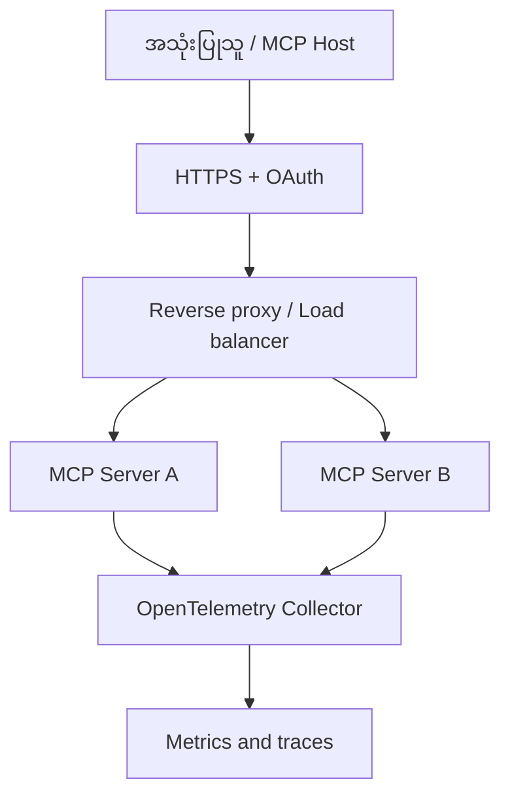
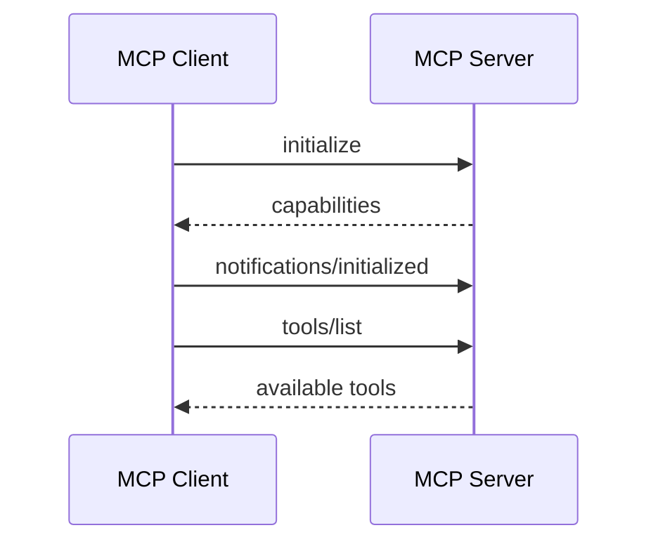

# MCP PDF formatting check

မြန်မာစာ၊ ဇယားများနှင့် ပုံကြမ်းများကို PDF ထဲတွင် မှန်ကန်စွာ ပြသရန် စမ်းသပ်ထားသော နမူနာဖြစ်သည်။

## Comparison table / နှိုင်းယှဉ်ဇယား

| အချက် | Local server | Production server |
| :--- | :--- | :--- |
| **Transport** | Standard input/output | Streamable HTTP |
| Scalability | One local process | Multiple instances behind a load balancer |
| Observability | Console logs (`console.log`) | OpenTelemetry traces and metrics |
| လုံခြုံရေး | စက်အတွင်း ချိတ်ဆက်ခြင်း | HTTPS နှင့် ခွင့်ပြုချက် စစ်ဆေးခြင်း |

#### Configuration example

```ts
const server_name = "learning-space";
const settings = {
  transport: "stdio",
  timeout_ms: 30_000,
};
console.log(server_name, settings);
```

> **မှတ်ချက်:** Code ထဲက underscore များနှင့် indentation များကို မပြောင်းလဲရပါ။

## Architecture / ဗိသုကာပုံကြမ်း



## Protocol lifecycle / ဆက်သွယ်မှု အဆင့်များ



## Existing ASCII diagram / ယခင်စာအုပ် ပုံကြမ်း

```text
+------------------------------------------+
|              MCP Host                    |
|  +------------------------------------+  |
|  |             MCP Client             |  |
|  +------------------------------------+  |
+------------------------------------------+
                     |
          Standard input / output
                     |
                     v
+------------------------------------------+
|           MCP Server Process             |
|  +------------------------------------+  |
|  |        StdioServerTransport        |  |
|  +------------------------------------+  |
|  |             Server Core            |  |
|  +------------+-----------+-----------+  |
|  | Resources  |   Tools   |  Prompts  |  |
|  +------------+-----------+-----------+  |
+------------------------------------------+
```

### Key takeaways / အဓိက မှတ်သားရန်

1. ဇယားကို အတန်းနှင့် ကော်လံများဖြင့် ပြသရမည်။
2. ပုံကြမ်းကို စာမျက်နှာနှစ်ခုအကြား မခွဲရပါ။
3. မြန်မာစာနှင့် code များကို ရှင်းလင်းစွာ ဖတ်နိုင်ရမည်။
